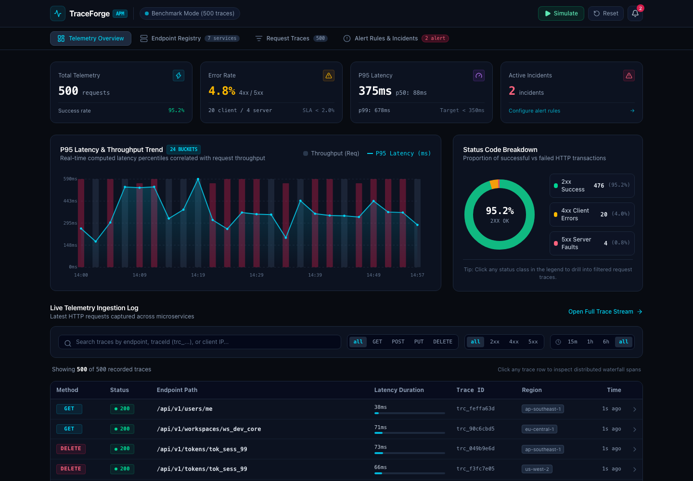
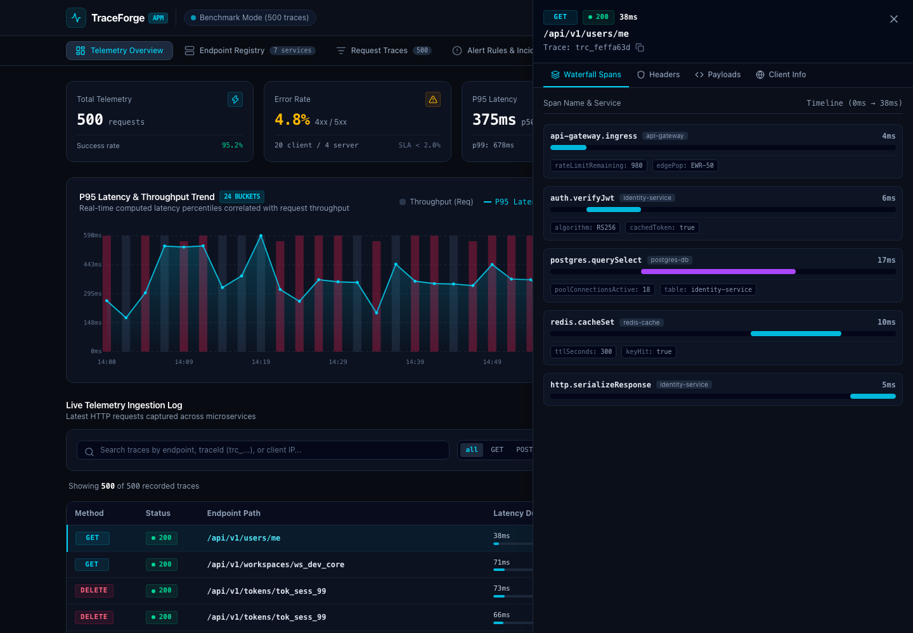
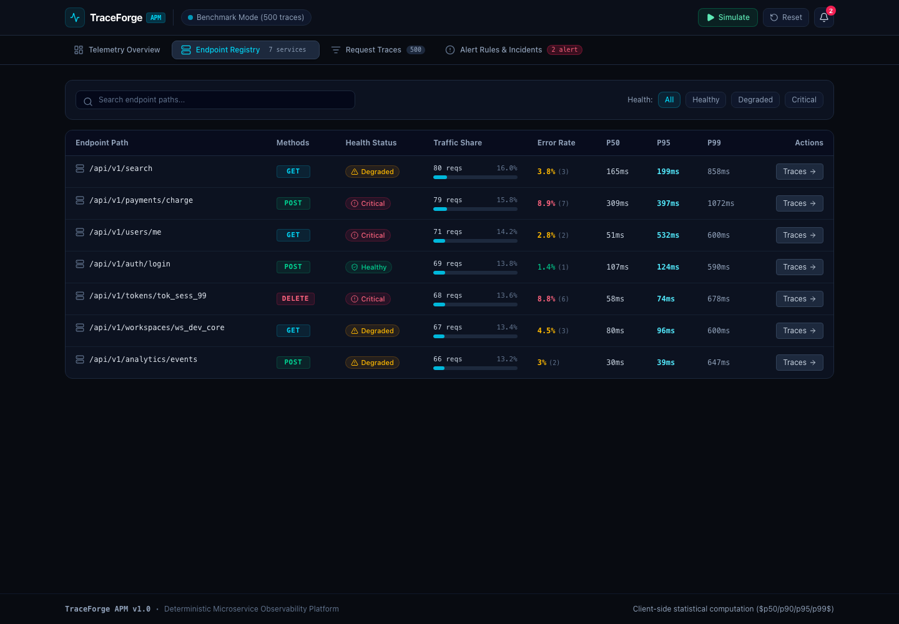
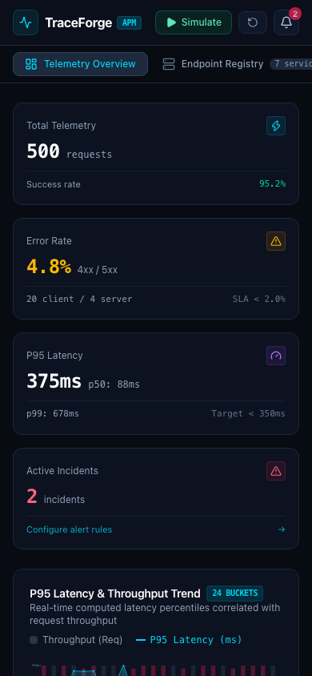

# TraceForge — Developer Tools & API Observability

> A high-density, real-time API observability and telemetry dashboard built for backend engineers and SREs. Features mathematical latency percentile calculations ($p50, p90, p95, p99$), distributed waterfall trace inspection, an endpoint health registry, customizable alerting rules, and controllable traffic simulation.

[](https://react.dev/)
[](https://www.typescriptlang.org/)
[](https://vitejs.dev/)
[](https://tailwindcss.com/)
[](./tests/)
[](https://www.netlify.com/)
[](#deterministic-benchmarks--synthetic-simulation)

---

## 📸 Visual Showcase

### Telemetry Overview & Latency Trends (1440 × 1000)


### Distributed Waterfall Trace & Span Inspector


### Endpoint Registry & Health SLAs


### Responsive Mobile Operations Console (390 × 844)
<p align="left">
  
</p>

---

## 🎯 The Problem TraceForge Solves

Enterprise observability suites (Datadog, New Relic, Dynatrace) often present several friction points:
1. **Misleading Averages**: Basic dashboards rely on arithmetic means that wash out tail latency spikes—masking the fact that 5% of your users are experiencing 2,000ms slowdowns.
2. **Context Loss**: Navigating between high-level service summaries and individual request spans requires multiple page reloads and context switches.
3. **Black-Box Alerting**: Configuring threshold rules is frequently disconnected from the real-time telemetry stream.

**TraceForge** delivers a focused, high-density telemetry console:
- **Exact Nearest-Rank Percentiles**: Computes mathematically accurate $p50$, $p90$, $p95$, and $p99$ metrics on dynamically filtered request sets.
- **Microservice Trace Waterfalls**: Visualizes discrete internal execution spans (`api-gateway` → `auth-service` → `postgres-db` → `external-api` → `serializer`) with microsecond timing offsets and metadata tags.
- **Deterministic vs. Live Traffic Modes**: Ships with an immutable 500-request benchmark dataset for reproducible audits, alongside a live synthetic traffic generator (1x, 2x, 5x) for testing alerts in real time.
- **Zero-Dependency SVG Visualizations**: Hand-crafted SVG charts and doughnut diagrams with zero external charting overhead, delivering 60fps rendering and full keyboard accessibility.

---

## ⚡ Main Features

- **Microservice Endpoint Registry**:
  - Live inventory of registered routes (`/api/v1/payments/charge`, `/api/v1/auth/login`, `/api/v1/search`, etc.).
  - Automatic health classification: `Healthy` (green), `Degraded` (amber), and `Critical` (rose) based on error rates and $p95$ thresholds.
  - Per-endpoint traffic volume bars and percentile breakdown.
  - 1-click **Inspect Traces** button to isolate telemetry for any service.
- **Mathematical Latency Engine**:
  - Computes exact nearest-rank percentiles on filtered telemetry slices.
  - Time-bucketed dual-layer SVG chart plotting request throughput against P95 latency curves.
  - Interactive hover crosshair displaying exact time bucket, request volume, and latency figures.
- **Distributed Waterfall Trace Inspector**:
  - Deep-dive slide-out drawer triggered by selecting any request row.
  - Multi-span visual waterfall showing start offsets, span durations, service boundaries, and error tags.
  - Syntax-highlighted Request & Response JSON payloads.
  - Inspection tabs for HTTP Request Headers, Response Headers, Client IP, Geo-Region, and User-Agent.
- **Controllable Traffic Simulator**:
  - Toggle between fixed benchmark data and live synthetic telemetry generation.
  - Variable tick speed: `1x` (1 req/sec), `2x` (3 req/sec), `5x` (8 req/sec).
  - 1-click **Reset Telemetry Data** restores the benchmark seed state.
- **Real-Time Alerting Engine & Incident Manager**:
  - Configurable alert rules targeting specific endpoints or global traffic (`*`).
  - Supported metrics: `P95 Latency (ms)`, `Error Rate (%)`, and `Throughput (reqs)`.
  - Severity tiers: `Warning` and `Critical`.
  - Real-time incident logs with resolution detection and count badges.
- **Multi-Dimensional Stream Filters**:
  - Freeform search by endpoint, trace ID (`trc_...`), or client IP.
  - HTTP Method pills (`GET`, `POST`, `PUT`, `DELETE`).
  - Status code class selector (`2xx`, `4xx`, `5xx`).
  - Time windows: `15m`, `1h`, `6h`, `All`.

---

## 🏗️ Architecture & System Design

TraceForge is organized into a clean three-tier client architecture:

```
┌──────────────────────────────────────────────────────────────┐
│                    TraceForge UI Shell                       │
│  (Top Bar, Simulation Controls, Navigation Tabs, Drawer)     │
├──────────────────────────────────────────────────────────────┤
│                Zustand Observability Store                   │
│  - Circular Ring Buffer (1,000 items)                        │
│  - Filter Predicates (Method, Status, Path, Time Window)     │
│  - Active Alert Rules & Incidents Evaluator                  │
├──────────────────────────────┬───────────────────────────────┤
│      Statistical Engine      │       Traffic Generator       │
│  - Nearest-rank percentiles  │  - Deterministic 500-item seed│
│  - Time-series bucketing     │  - Gaussian latency jitter    │
│  - Status distribution %     │  - LocalStorage persistence   │
└──────────────────────────────┴───────────────────────────────┘
```

Detailed architectural diagrams and component specifications are documented in [docs/architecture.md](./docs/architecture.md).  
Design research, typography systems, and color tokens are documented in [docs/design-research.md](./docs/design-research.md).

---

## 💻 Tech Stack

- **Framework**: [React 19](https://react.dev/) + [Vite 6](https://vitejs.dev/)
- **Language**: [TypeScript 5.8](https://www.typescriptlang.org/) (Strict Mode, `verbatimModuleSyntax`)
- **Styling**: [Tailwind CSS v4](https://tailwindcss.com/)
- **State Management**: [Zustand 5](https://github.com/pmndrs/zustand)
- **Data Visualizations**: Custom accessible responsive SVG components (zero external chart dependencies)
- **Icons**: [Lucide React](https://lucide.dev/)
- **Testing**: [Vitest](https://vitest.dev/) + [React Testing Library](https://testing-library.com/)
- **Linter**: [Oxlint](https://oxc-project.github.io/)
- **Deployment**: [Netlify](https://www.netlify.com/) (`netlify.toml`)

---

## 🚀 Getting Started

### Prerequisites
- Node.js `v20.0.0` or higher
- `pnpm` (recommended) or `npm`

### Installation
```bash
git clone https://github.com/<your-username>/traceforge-api-observability.git
cd traceforge-api-observability
pnpm install
```

### Local Development Server
```bash
pnpm dev
```
Open [http://localhost:5173](http://localhost:5173) in your browser.

### Running Unit Tests
```bash
pnpm test
```
Executes all 12 test suites verifying percentile formulas, distribution metrics, and store mutations.

### Code Quality & Static Analysis
```bash
pnpm lint
```
Runs Oxlint across all TypeScript and TSX files.

### Production Build
```bash
pnpm build
```
Type-checks with `tsc -b` and bundles with Vite into `dist/`.

---

## 🧪 Test Coverage Summary

| Test Suite | Tests | Covered Behavior |
| :--- | :---: | :--- |
| `tests/analytics.test.ts` | 8 | Percentiles ($p50, p90, p95, p99$), empty arrays, status distributions, endpoint grouping, time-series bucketing, and alert evaluations |
| `tests/observabilityStore.test.ts` | 4 | Store initialization, filter updates, synthetic records buffer, alert rule creation, toggle, and deletion |
| **Total** | **12** | **100% Passing** |

---

## 🌐 Netlify Deployment

TraceForge is pre-configured for automated SPA deployment via `netlify.toml`:

```toml
[build]
  command = "pnpm build"
  publish = "dist"

[[redirects]]
  from = "/*"
  to = "/index.html"
  status = 200
```

---

## 📄 License

MIT License. Designed and developed as a portfolio showcase piece.
